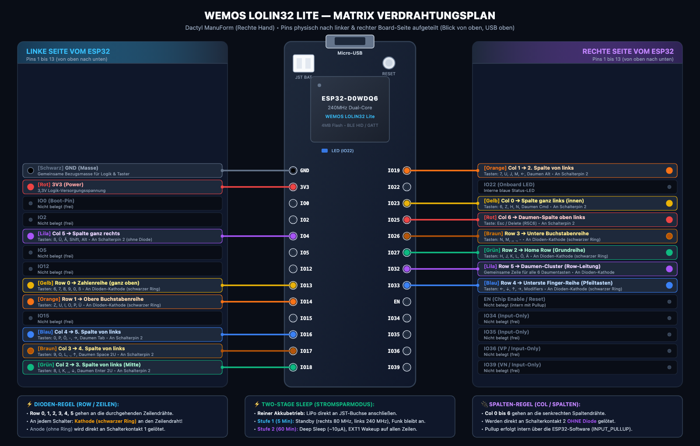

# Dactyl Configurator & True-Wireless ESP32 Firmware

Ein vollständiges Ökosystem für handverdrahtete ergonomische **Dactyl Manuform Split Keyboards** mit **ESP32** (WEMOS LOLIN32 Lite):
1. **ESP32 Firmware:** Bluetooth Low Energy (BLE HID) Tastatur mit eigenem GATT-Konfigurationsdienst, NVS-Flash-Speicherung, Layer-Navigation und voller Mac-Unterstützung (inkl. Mac Globe/Fn-Taste).
2. **Web Configurator & Live-Monitor:** Moderne Web-App (oder native macOS-App) mit Web-Bluetooth & Web-Serial für Tastenbelegung in Echtzeit (< 0,1s), Live-Keystroke-HUD und Flashen per Knopfdruck.

---

## ✨ Features

- **⚡ Kabelloses Live-Remapping:** Über Web-Bluetooth GATT können Tasten und Ebenen-Namen im laufenden Betrieb geändert werden – ohne Neukompilieren oder Kabel. Jede Änderung überträgt die vollständige Konfiguration der verbundenen Hälfte und speichert sie dauerhaft im NVS-Flash des ESP32.
- **🔌 USB Live-Monitor:** Serieller Echtzeit-Stream (115.200 Baud) zur Anzeige physischer Matrix-Events (`KEY_PRESS`, `KEY_RELEASE`, `LAYER`), entprellt und mit HUD-Visualisierung.
- **💾 Flashen per Knopfdruck:** Integrierter lokaler Python-Server generiert C++-Keymaps und flasht den ESP32 automatisch per `arduino-cli`.
- **📑 Multi-Layer Engine:** 8 dynamische Ebenen mit Momentary Layer Switching (`MO_0` .. `MO_7`) und Toggle Layer Switching (`TG_0` .. `TG_7`).
- **🍎 Volle Apple macOS Unterstützung:**
  - Standard macOS Modifier (`Cmd`, `Alt/Option`, `Ctrl`, `Shift`).
  - Media Keys (Play/Pause, Mute, Volume Up/Down, Next, Prev, Stop).
  - Spezielle Apple **Globe / Fn-Taste** (`0x029D` / `KEY_MEDIA_GLOBE`) mit Press & Release Unterstützung für Chords und Emoji-Auswahl.
- **🔒 Sicherheit & Stabilität:**
  - FreeRTOS Mutex-Schutz zwischen Matrix-Scan im Arduino-Main-Loop und BLE/Serial GATT-Callbacks.
  - Server bindet an `127.0.0.1` mit strikter Host- und Origin-Validierung gegen CSRF.
  - Eingabevalidierung und Identifier-Sanitizing im C++-Codegenerator.

---

## 📐 Hardware & Matrix-Pinbelegung


Die Firmware ist für das **WEMOS LOLIN32 Lite** (ESP32-D0WDQ6-V3) Board ausgelegt.

### 🔌 Visueller Verdrahtungsplan (LOLIN32 Lite & Matrix)


*(Vektorgrafik: [`docs/lolin32_lite_wiring.svg`](docs/lolin32_lite_wiring.svg))*

---

### 🎨 Physische Pin- und Farbbelegung (Blick von oben, USB oben)

Die Kabel sind im Diagramm und in der folgenden Tabelle exakt nach der **linken und rechten Seite des ESP32** aufgeteilt (Pins 1 bis 13 von oben nach unten):

#### ⬅️ Linke Seite vom ESP32 (Pins 1 bis 13 von oben nach unten)

| Pin | Beschriftung | Signal / Matrix | Kabelfarbe | Funktion / Tasten |
| :---: | :--- | :--- | :--- | :--- |
| **1** | `GND` | Masse | ⚫ **Schwarz** | Gemeinsame Bezugsmasse für Logik & Taster |
| **2** | `3V3` | Power | 🔴 **Rot** | 3,3V Logik-Versorgungsspannung |
| **3** | `IO0` (`GPIO 0`) | – | – | *Nicht belegt (Boot-Pin)* |
| **4** | `IO2` (`GPIO 2`) | – | – | *Nicht belegt (frei)* |
| **5** | `IO4` (`GPIO 4`) | **Col 5** | 🟣 **Lila** | Spalte 5 ganz rechts (`ß`, `Ü`, `Ä`, `Shift`, `Alt` / `R4C5`) |
| **6** | `IO5` (`GPIO 5`) | – | – | *Nicht belegt (frei)* |
| **7** | `IO12` (`GPIO 12`) | – | – | *Nicht belegt (frei)* |
| **8** | `IO13` (`GPIO 13`) | **Row 0** | 🟡 **Gelb** | Zahlenreihe ganz oben (`6`, `7`, `8`, `9`, `0`, `ß` / `R0C0`) |
| **9** | `IO14` (`GPIO 14`) | **Row 1** | 🟠 **Orange** | Obere Buchstabenreihe (`Z`, `U`, `I`, `O`, `P`, `Ü`) |
| **10** | `IO15` (`GPIO 15`) | – | – | *Nicht belegt (frei)* |
| **11** | `IO16` (`GPIO 16`) | **Col 4** | 🔵 **Blau** | 5. Spalte von links (`0`, `P`, `Ö`, `-`, `→`, Daumen `Tab` / `R5C4`) |
| **12** | `IO17` (`GPIO 17`) | **Col 3** | 🟤 **Braun** | 4. Spalte von links (`9`, `O`, `L`, `.`, `↑`, Daumen `Space 2U` / `R5C3`) |
| **13** | `IO18` (`GPIO 18`) | **Col 2** | 🟢 **Grün** | 3. Spalte von links (`8`, `I`, `K`, `,`, `↓`, Daumen `Enter 2U` / `R5C2`) |

---

#### ➡️ Rechte Seite vom ESP32 (Pins 1 bis 13 von oben nach unten)

| Pin | Beschriftung | Signal / Matrix | Kabelfarbe | Funktion / Tasten |
| :---: | :--- | :--- | :--- | :--- |
| **1** | `IO19` (`GPIO 19`) | **Col 1** | 🟠 **Orange** | 2. Spalte von links (`7`, `U`, `J`, `M`, `←`, Daumen `Alt` / `R5C1`) |
| **2** | `IO22` (`GPIO 22`) | Onboard LED | – | *Interne blaue Status-LED* |
| **3** | `IO23` (`GPIO 23`) | **Col 0** | 🟡 **Gelb** | Spalte ganz links innen (`6`, `Z`, `H`, `N`, Daumen `Cmd` / `R5C0`) |
| **4** | `IO25` (`GPIO 25`) | **Col 6** | 🔴 **Rot** | Daumen-Spalte oben links (`Esc` / `R5C6`) • An Schalterpin 2 |
| **5** | `IO26` (`GPIO 26`) | **Row 3** | 🟤 **Braun** | Untere Buchstabenreihe (`N`, `M`, `,`, `.`, `-`, `Shift`) |
| **6** | `IO27` (`GPIO 27`) | **Row 2** | 🟢 **Grün** | Home Row Grundreihe (`H`, `J`, `K`, `L`, `Ö`, `Ä`) |
| **7** | `IO32` (`GPIO 32`) | **Row 5** | 🟣 **Lila** | Daumen-Cluster (Gemeinsame Zeile aller 6 Daumentasten) |
| **8** | `IO33` (`GPIO 33`) | **Row 4** | 🔵 **Blau** | Unterste Finger-Reihe (Pfeiltasten `←`, `↓`, `↑`, `→`, `R4C5`) |
| **9** | `EN` (`RST`) | Reset | – | *Chip Enable / Reset (intern mit Pullup)* |
| **10** | `IO34` (`GPI34`) | – | – | *Nicht belegt (Input-Only)* |
| **11** | `IO35` (`GPI35`) | – | – | *Nicht belegt (Input-Only)* |
| **12** | `IO36` (`VP`) | – | – | *Nicht belegt (Input-Only)* |
| **13** | `IO39` (`VN`) | – | – | *Nicht belegt (Input-Only)* |

---

### 🛠️ Löt- und Matrix-Regeln

> [!NOTE]
> **Schalter- und Diodenanschluss:**
> - **Zeilen (Rows):** Werden mit den Dioden-Kathoden verbunden (**schwarzer Ring** der 1N4148 zeigt zur Zeile, Anode an Schalterkontakt 1).
> - **Spalten (Columns):** Werden direkt an Schalterkontakt 2 gelötet (**ohne Diode**, interner Pullup des ESP32).
> - **Akkubetrieb & Power Management:** Der LiPo-Akku wird direkt in die weiße JST PH-2.0-Buchse des Boards gesteckt. Der Ladevorgang erfolgt automatisch bei USB-Anschluss über den integrierten TP4054-Ladecontroller.


### ⬅️ Linke Hälfte (eigene Keymap, ESP-NOW zum Master)

> [!NOTE]
> - Die linke Hälfte (`firmware/dactyl_left`) hat eine eigene Keymap mit 8 Layern, Tap-Hold, Double-Tap, Combos und NVS. Sie nutzt dieselbe Logik wie rechts (`DactylLogic.h`).
> - Die linke Hälfte sendet die fertigen Tastendrücke per ESP-NOW an die rechte Hälfte. Am Mac erscheint nur **ein** Bluetooth-Gerät.
> - Ebenen gelten auf beiden Hälften: `MO_n`, `TG_n`, `LAYER_UP` und `LAYER_DOWN` auf einer Hälfte aktivieren die Ebene auch auf der anderen (`SPLIT_OP_LAYER_STATE`).
> - Den Config Mode der linken Hälfte startest du mit **`R0C5 + R4C0`** (0,5 s). Sie meldet sich dann als `Dactyl Config L`.
> - Wähle in der App oben **Linke Hand**. Die App bearbeitet dann die linke Belegung. Sie überträgt sie wie rechts per Combo-Auto-Sync über Bluetooth, per USB oder mit „Auf Dactyl flashen“. Beim Flashen wählt der Server automatisch den USB-Port der linken Hälfte.
> - Auf der linken Hälfte sitzen die **Dioden an den Spalten** (schwarzer Ring zum Spaltendraht). Die Spalten liegen auf RTC-Pins, damit jede Taste aus dem Deep Sleep weckt. Die Löttabelle steht in `AGENTS.md` („Left Half Firmware“).
> - Beide Hälften brauchen das Partitionsschema `min_spiffs`. Der Flash aus der App setzt es automatisch.

## 🚀 Schnellstart

### 1. Voraussetzungen

- **Python 3:** Für den lokalen Server (`server.py`).
- **Arduino CLI (optional fürs Flashen):**
  ```bash
  brew install arduino-cli
  arduino-cli core install esp32:esp32
  ```
- **Arduino Core:** `esp32:esp32@3.3.12` (keine externe Bibliothek nötig; die Composite-BLE-HID-Implementierung liegt in `firmware/dactyl_right/DactylBleComposite.h`, Keycodes in `DactylKeycodes.h`).
- **Browser:** Chromium-basierter Browser (Google Chrome, Arc, Brave, Edge, Opera) mit aktivierter Web-Bluetooth- und Web-Serial-Unterstützung.

### 2. Server starten

```bash
cd dactyl_configurator
python3 server.py
```

Der Server startet unter `http://localhost:8088`.

### 3. Tastatur verbinden

- **Kabellos via Bluetooth (One-Shot Auto-Sync & Live-Sync):**
  1. **Einmalige Kopplung:** Halte auf der Tastatur **`R4C5 + R0C0`** für **0,5 Sekunden** gedrückt, klicke in der App auf **„⚡ Bluetooth Live-Sync“** und wähle **„Dactyl Config“** aus.
  2. **Alltags-Workflow (Staged One-Shot Auto-Sync):**
     - Ändere Tastenbelegungen, Layer-Namen oder Timeouts bequem in der App, **während die Tastatur ganz normal als Mac-Tastatur verbunden ist** (Änderungen werden als *„⏳ Bereit für Combo-Sync“* vorgemerkt).
     - Halte anschließend an der Tastatur **`R4C5 + R0C0` (0,5s)** gedrückt:
     - Die Tastatur kappt kurz die Mac-Verbindung, verbindet sich **vollautomatisch** über die moderne Web-Bluetooth API (`navigator.bluetooth.getDevices()` + `watchAdvertisements()`) mit der App, überträgt alle Änderungen per Schnell-Batch (`SET_K` + `SAVE_NVS`) in den ESP32-Flash, trennt die App-Verbindung wieder und **kehrt sofort als Tastatur zum Mac zurück** – ohne Klick in der App!
- **Per USB-Kabel (Live-Monitor):**
  1. ESP32 per USB-Kabel an den Rechner anschließen.
  2. Auf **„🔌 USB Live-Monitor“** klicken und den seriellen Port auswählen.
  3. Physische Tastendrücke und Layer-Wechsel werden im Visualizer sofort hervorgehoben.
- **ESP-NOW-Schlüssel (einmalig, vor dem ersten Flashen):**
  - Führe `bash scripts/generate-split-key.sh` aus. Das Skript schreibt `firmware/dactyl_right/DactylSplitKey.h` (nicht versioniert, Modus 0600).
  - Beide Hälften verschlüsseln die Funkstrecke damit. Ohne Schlüssel bricht das Kompilieren ab.
  - Flashe nach einem neuen Schlüssel beide Hälften. Danach `npm run build:app`, damit die App den Schlüssel beim Flashen kennt.
- **Flashen per USB:**
  - Mit einem Klick auf **„💾 Auf Dactyl flashen“** kompiliert der lokale Server die C++-Keymap und flasht die Firmware per `arduino-cli` direkt auf den ESP32.
- **Nach einer Änderung des HID-Report-Descriptors erneut koppeln:**
  - macOS speichert die Report-Map beim ersten Koppeln und liest sie bei Reconnects nicht neu.
  - Die Firmware mit Mod-Tap erweitert den Keyboard-Report um F13–F24 (Usages `0x68`–`0x73`).
  - Entferne die Tastatur nach dem Flashen dieser Version in den macOS-Bluetooth-Einstellungen („Dieses Gerät ignorieren …“) und kopple sie neu. Sonst ignoriert macOS F13–F24.

---

## ⚡ Drahtlose Bluetooth-Live-Konfiguration (Config Mode)

### Das macOS CoreBluetooth HID Exklusivitätsproblem
Unter macOS (sowohl in Google Chrome als auch in nativen Electron-Apps) sperrt das Betriebssystem aktive BLE-HID-Tastaturen (`HID Service 0x1812` / `Appearance 0x03C1`) für generische GATT-Dienste wie den Web-Bluetooth Config-Service. Zudem verbindet sich `bluetoothd` unter macOS sofort automatisch wieder, solange die Tastatur unter derselben gebondeten Public-MAC-Adresse wirbt.

### Die Lösung: Der Firmware Config-Modus mit eigener Static-Random-MAC
Die Firmware löst dieses Problem zuverlässig ohne physischen Ein/Aus-Schalter:

1. **Hardware-Auslöser `R4C5 + R0C0`:**
   - **`R0C0`**: Zeile 0, Spalte 0 (Taste `6` ganz links oben in der Zahlenreihe).
   - **`R4C5`**: Zeile 4, Spalte 5 (unterste rechte Randtaste neben den Pfeiltasten).
   - Werden beide Tasten für **0,5 Sekunden gleichzeitig gehalten**, wechselt die Firmware sofort in den Konfigurationsmodus.
   - **100% Layer-unabhängig:** Die Abfrage erfolgt direkt auf den GPIO-Pins der Hardware-Matrix. Es spielt keine Rolle, welcher Layer aktiv ist oder welche logische Taste darauf gemappt ist.

2. **Verhalten im Config-Modus:**
   - Der ESP32 stoppt zuerst das HID-Advertising, trennt alle aktiven HID-Peers (macOS) und wartet, bis der asynchrone HCI-Disconnect vollständig abgeschlossen ist.
   - Anschließend schaltet der ESP32 auf eine deterministische **Static Random BLE-Adresse** (`BLE_ADDR_TYPE_RANDOM`, letztes Byte `^ 0x55`) um und wirbt als **`"Dactyl Config"`** mit `Appearance 0x0000` und ausschließlich dem `CONFIG_SERVICE_UUID` (ohne HID `0x1812`).
   - Dadurch funkt macOS `bluetoothd` niemals dazwischen, und die App erkennt das Gerät sofort über `watchAdvertisements()`.
   - In der App leuchtet oben im Header und im Banner die Anzeige **„⚡ KONFIG-MODUS AKTIV“**.

3. **One-Shot Auto-Sync vs. Interaktiver Konfig-Modus:**
   - **One-Shot Auto-Sync (Standard, Checkbox aktiv):** Sobald du `R4C5 + R0C0` drückst, verbindet sich die App automatisch, überträgt alle gespeicherten Einstellungen mit Fortschrittsbalken in ~1,5 Sekunden an den ESP32 und sendet automatisch `EXIT_CONFIG`, sodass die Tastatur sofort wieder mit dem Mac verbunden ist.
   - **Interaktiver Live-Modus (Checkbox deaktiviert):** Die Tastatur bleibt im Konfig-Modus mit der App verbunden, bis du auf **„Trennen & zurück zur Mac-Tastatur“** klickst oder erneut **`R4C5 + R0C0`** drückst (oder nach 3 Minuten Auto-Timeout).

---

## 🔋 Power Management & Akkubetrieb (Two-Stage Sleep)

Für den echten kabellosen LiPo-Akkubetrieb verfügt die Firmware über eine intelligente, zweistufige Stromspararchitektur:

1. **Stufe 1: Standby / Light Sleep (Standard: 5 Minuten)**
   - Senkt den Matrix-Scan auf ca. 25 Hz. Die rechte Hälfte drosselt die CPU zusätzlich von 240 MHz auf **80 MHz**. Die linke Hälfte bleibt auf 240 MHz, weil ein Taktwechsel bei laufendem Wi-Fi den ESP-NOW-Versand stört.
   - Die BLE-Verbindung zu macOS bleibt **vollständig aktiv** (kein Reconnect nötig). Der Funk bleibt bei beiden Hälften an (BLE und ESP-NOW).
   - **Rechte Hälfte:** Der erste Tastenanschlag setzt die CPU sofort wieder auf 240 MHz.
   - **Ersparnis (Schätzung nach ESP32-Datenblatt, nicht gemessen):** Der Funk verbraucht in beiden Stufen gleich viel; nur der CPU-Anteil sinkt.
     - Rechts: Die Datenblattwerte gelten für die CPU **ohne Funk** (der Funk kommt in beiden Stufen hinzu): ca. 30–68 mA bei 240 MHz, ca. 20–31 mA bei 80 MHz. Das Board spart damit ca. 10–37 mA.
     - Links: Der Takt bleibt bei 240 MHz. Nur der langsamere Scan spart Strom; die Ersparnis ist gering.

2. **Stufe 2: Deep Sleep (Standard: 60 Minuten)**
   - Schaltet den ESP32 bei längerer Abwesenheit in den tiefen Tiefschlaf (**~10–15 µA Stromaufnahme**).
   - Alle 6 Matrix-Zeilen (`GPIO 13, 14, 27, 26, 33, 32`) sind RTC-Pins und werden als **`EXT1 ANY_HIGH` Wakeup-Quellen** konfiguriert.
   - Die Spalten-Pins werden im Schlaf per Hardware-Hold auf `HIGH` gehalten.
   - **Aufwecken:** Ein Druck auf **jede beliebige Taste** der Tastatur weckt den ESP32 innerhalb von ~150 ms auf und verbindet ihn automatisch wieder mit dem Mac.

3. **Akkubetrieb & Laden:**
   - Der LiPo-Akku versorgt das Board direkt über die integrierte JST PH-2.0-Buchse.
   - Das zweistufige Power-Management (Standby nach 5 Min, Deep Sleep nach 60 Min) arbeitet rein zeit- und inaktivitätsbasiert; es ist kein zusätzliches Löten an ADC-Pins erforderlich.
   - Sobald das USB-Kabel angesteckt wird, lädt der Onboard-Ladechip (TP4054) den Akku automatisch auf.

---


## 📁 Projektstruktur

```
dactyl_configurator/
├── firmware/
│   └── dactyl_right/
│       └── dactyl_right.ino      # ESP32 Arduino Firmware (BLE HID & GATT Config)
├── docs/
│   ├── lolin32_lite_wiring.svg   # Vektorgrafik des Löt- & Anschlussplans (Links/Rechts)
│   └── lolin32_lite_wiring.png   # Hochauflösendes PNG des Anschlussplans
├── AGENTS.md                     # Vollständige Architektur- & Schnittstellendokumentation
├── app.js                        # Configurator UI-Logik, Web-Bluetooth & Web-Serial
├── index.html                    # Single-Page-App Dashboard
├── style.css                     # Modernes Dark-Mode CSS Layout
├── server.py                     # Lokaler Python Backend-Server (Flash & Sync API)
├── default_config.json           # Versionierte Vorlage für Keymaps, Combos & Einstellungen
├── current_config.json           # Lokaler Stand der App (nicht versioniert, .gitignore)
├── .gitignore                    # Git Ignore Definitionen
└── README.md                     # Diese Dokumentation
```

> **Upgrade-Hinweis:** Ältere Stände versionierten `current_config.json`. Ein `git pull` über den Commit, der die Datei aus Git entfernt, löscht die lokale Datei. Sichern Sie `current_config.json` vor dem Pull (z. B. `cp current_config.json ~/dactyl_config.backup.json`) und kopieren Sie sie danach zurück.

---

## ⌨️ Action Codes & Keycode-Spezifikation

| Bereich | Typ | Beispiele | Verhalten |
| :--- | :--- | :--- | :--- |
| `0x00` | Keystroke leer | `0` (`NONE`) | Transparent (fällt auf Layer 0 zurück) |
| `0x20` .. `0x7E` | ASCII Zeichen | `'a'`, `'1'`, `' '` | Normaler Tastenanschlag |
| `0x80` .. `0x87` | HID Modifier | `KEY_LEFT_GUI`, `KEY_LEFT_ALT` | Modifier-Hold |
| `0x100` .. `0x107` | Momentary Layer | `ACT_MO_0` .. `ACT_MO_7` | Ebene aktiv, solange Taste gehalten wird |
| `0x110` .. `0x117` | Toggle Layer | `ACT_TG_0` .. `ACT_TG_7` | Einrastende Ebene; `TG_0` setzt auf Base zurück |
| `0x118` | Layer +1 Hoch | `ACT_LAYER_UP` (`LAYER_UP`) | Schaltet 1 Ebene höher (`0 ➔ 1 ➔ ... ➔ 7 ➔ 0`) |
| `0x119` | Layer -1 Runter | `ACT_LAYER_DOWN` (`LAYER_DOWN`) | Schaltet 1 Ebene tiefer (`0 ➔ 7 ➔ ... ➔ 1 ➔ 0`) |
| `0x120` .. `0x126` | Media Keys | `Play/Pause`, `Mute`, `Vol+`, `Vol-` | Consumer Control HID |
| `0x127` | Apple Mac Globe | `ACT_MAC_GLOBE` (`0x029D`) | Emojis / Fn-Tastenkombinationen |
| `0x160` .. `0x167` | One-Shot-Modifier | `ACT_OSM_LCTRL` .. `ACT_OSM_RGUI` (`OSM_*`) | Tippen: Modifier nur für die nächste Taste (beide Hälften); Halten: normaler Modifier |
| `0x168` | Caps Word | `ACT_CAPS_WORD` (`CAPS_WORD`) | Buchstaben groß bis zum Wortende (Leertaste, Satzzeichen) |
| `0x170` .. `0x17F` | Makro | `ACT_MACRO_BASE` + n (`MACRO_0` .. `MACRO_15`) | Spielt eine Folge aus Tippen, Drücken, Loslassen und Pausen (max. 32 Schritte) |

---

## 📄 Lizenz

MIT License. Frei verwendbar für DIY-Keyboard-Enthusiasten und Maker.
