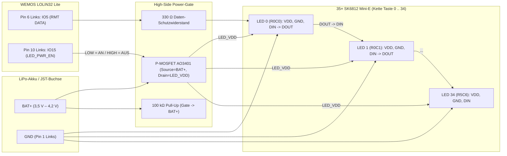
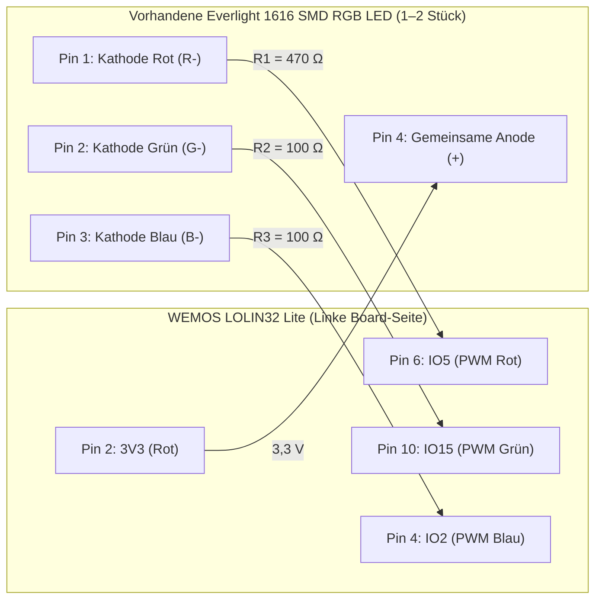

# Einbauplan für RGB-LEDs (`LED EL SMD RGB` / `K07-957` vs. `SK6812 Mini-E`)

Dieses Dokument beschreibt:
1. Die technischen Eigenschaften deiner vorhandenen **75 analogen SMD-RGB-LEDs** (`LED EL SMD RGB` / Charge `K07-957`, **Everlight `19-337/R6GHBHC-A01/2T`**) und wie du sie sinnvoll als **Status-/Layer-Indikator** oder **Underglow** nutzt.
2. Warum du für eine **Einzel-Tastenbeleuchtung aller 70 Tasten (Per-Key RGB)** stattdessen **adressierbare `SK6812 Mini-E`** verwenden solltest — inklusive komplettem Schalt-, Verdrahtungs- und Stromsparplan für beide Hälften der **Dactyl Manuform True-Wireless Split-Tastatur** (Board: **WEMOS LOLIN32 Lite**).

---

## 1. Bauteil-Steckbrief deiner vorhandenen LEDs (`Everlight 19-337/R6GHBHC-A01/2T`)

Die Beschriftung `LED EL SMD RGB` (mit dem Kommissions-/Chargencode `K07-957`) bezeichnet bei Reichelt Elektronik die **Everlight `19-337/R6GHBHC-A01/2T`**.

| Eigenschaft | Technische Daten | Bedeutung für den Einbau |
|---|---|---|
| **Hersteller / Teilenummer** | Everlight `19-337/R6GHBHC-A01/2T` | Analoge 3-Chip-RGB-LED **ohne eigenen Controller-IC** |
| **Bauform** | SMD `1616` (`0606` imperial) | **1,6 mm × 1,6 mm × 0,35 mm** (extrem klein für freies Hand-Wiring) |
| **Anschlüsse** | **4 Lötpads auf der Unterseite** | **Pin 4 = Gemeinsame Anode (`+`)**, Pins 1–3 = Kathoden (`-`) für R, G, B |
| **Durchlassspannung ($V_F$)** | **Rot (`R6`, 624 nm):** typ. `2,05 V` (max. `2,40 V`)<br>**Grün (`GH`, 525 nm):** typ. `3,25 V` (max. `3,90 V`)<br>**Blau (`BH`, 470 nm):** typ. `3,25 V` (max. `3,90 V`) | Jeder Farbkanal benötigt zwingend einen **eigenen Vorwiderstand** |
| **Nennstrom ($I_F$)** | `20 mA` pro Kanal (max. `25 mA`) | Im LiPo-Akkubetrieb reichen **`1–3 mA` pro Kanal** für klare Sichtbarkeit |
| **Abstrahlwinkel** | `120°` | Breite Streuung, gut für Statusanzeige und Gehäuse-Underglow |

### Pinbelegung & Diodentest vor dem Löten

Die LED besitzt an einer Ecke eine grüne Markierung bzw. abgeschrägte Kante (Polaritätsmarkierung):

```text
      Blick von OBEN (durch die Linse)
      ┌───────────────────────┐
      │ (1) R-         (4) +  │  <-- Markierte Ecke = Pin 4 (Common Anode +)
      │                       │
      │ (2) G-         (3) B- │
      └───────────────────────┘
```

> [!IMPORTANT]
> **Vor dem Verlöten mit dem Multimeter prüfen:**
> Stelle das Multimeter auf den **Diodentest**. Halte die **rote Messspitze (`+`)** an das markierte Pad (**Pin 4**) und tippe mit der **schwarzen Messspitze (`-`)** nacheinander auf die anderen drei Pads. Die LED leuchtet dann jeweils schwach Rot, Grün oder Blau auf. So vermeidest du Verpolung vor dem Vergießen mit Heißkleber oder Epoxidharz.

---

## 2. Einzel-Tastenbeleuchtung (70 Tasten / Per-Key): Vorhandene LEDs vs. Alternativen

Deine Dactyl Manuform hat **35 Tasten rechts** und **35 Tasten links** = **70 Tasten gesamt**. Rechnerisch würden deine 75 LEDs (mit 5 Stück Reserve) zwar reichen, aber technisch ist die Bauform `1616` (analog, 4 Bodenpads) für 70 Einzel-Tasten in einer handverdrahteten Dactyl ungeeignet.

### 2.1 Warum deine vorhandenen `Everlight 1616` unter 70 Tasten problematisch sind

1. **Mechanik am MX-Switch:** Ein MX-Schalter hat auf der Unterseite/Oberseite eine LED-Aussparung, aber deine LED ist nur **`1,6 × 1,6 × 0,35 mm`** groß und hat **keine seitlichen Beinchen**. Ohne Platine (PCB) fällt sie durch jede Öffnung hindurch und lässt sich am Schaltergehäuse kaum fixieren.
2. **280 Mikro-Lötstellen frei in der Luft:** Du müsstest an 70 LEDs jeweils 4 Drähte im Abstand von `0,5 mm` frei Hand anlöten (`70 × 4 = 280 Pads`). Sobald du Draht 2 anlötest, schmilzt auf `1,6 mm` Fläche fast immer das Lot an Pad 1 wieder auf.
3. **210 Einzelwiderstände nötig:** Wegen der unterschiedlichen Durchlassspannungen von Rot (`2,05 V`) und Grün/Blau (`3,25 V`) benötigt jede der 70 LEDs 3 eigene Vorwiderstände = **210 Widerstände** im Gehäuse.
4. **Keine Einzel-Tasten-Steuerung ohne Matrix-Treiber:** Da die LEDs keinen integrierten Controller haben, leuchten bei Parallelschaltung alle 35 Tasten einer Hälfte immer in **derselben Farbe**. Für echte Einzel-Tasten-Steuerung bräuchtest du pro Hälfte `35 × 3 = 105` PWM-Kanäle über I²C-Charlieplexing-Treiber (`IS31FL3731` / `IS31FL3733`) mit dutzenden zusätzlichen Matrix-Drähten.

### 2.2 Vergleich mit besseren LED-Alternativen für 70 Einzel-Tasten

| LED-Typ | Bauform & Montage am Switch | Verdrahtung pro Hälfte (35 Tasten) | Einzelne Farbe pro Taste? | Zusatzbauteile pro Hälfte | Preis (75–100 Stk.) |
|---|---|---|---|---|---|
| **1. `SK6812 Mini-E`** *(Top-Empfehlung für Per-Key RGB)* | `3,2 × 2,8 mm` mit **4 langen, abgewinkelten Metall-Flügeln ("Gullwing-Beinchen")**. Liegt perfekt über dem LED-Fenster von MX-Switches. | `VCC` & `GND` als durchgehende Schienen + **1 Datenleitung** (`DOUT` -> `DIN` von Taste zu Taste). Belegt nur **1 Daten-Pin am ESP32 (`GPIO 5`)**! | **Ja, voll adressierbar** (jede der 70 Tasten eigene Farbe, z. B. passend zur Tastenbelegung auf dem aktiven Layer). | **0 Vorwiderstände** (Konstantstromquelle ist in jeder LED integriert) + **1× P-MOSFET** zum Abschalten im Deep Sleep. | ca. **8–12 €** |
| **2. `WS2812B` auf Mini-Rundplatine (9 mm / 10 mm PCB)** | Fertig verlötet auf kleiner runder Platine mit 6 großen Lötpads (`+5V`, `GND`, `DI`, `DO`). Wird von unten unter den Switch geklebt. | Sehr einfach mit normaler Litze zu löten, da große Pads auf der Mini-Platine. Nur **1 Daten-Pin am ESP32 (`GPIO 5`)**. | **Ja, voll adressierbar**. | **0 Vorwiderstände** + **1× P-MOSFET** für Deep Sleep. | ca. **10–15 €** |
| **3. `1,8 mm` oder `2×3×4 mm` THT-LED (einfarbig)** | Klassische bedrahtete LED mit **2 langen Drahtbeinchen**, wird direkt durch die zwei LED-Löcher im MX-Switch gesteckt. | Drahtbeinchen werden direkt zu Reihen/Spalten gebogen. Sehr stabil ohne Kleber. | Nein (einheitliche Hintergrundfarbe). | 35 Widerstände + 1 MOSFET. | ca. **3–5 €** |
| **4. Vorhandene `Everlight 1616` (`LED EL SMD RGB`)** | `1,6 × 1,6 mm` ohne Beinchen. | 4 Kupferlackdrähte + 3 Widerstände pro LED. | Nein (nur für **1–2 Status-LEDs** oder **6–10 Underglow-LEDs** sinnvoll). | 3 Widerstände pro LED (+ 3 MOSFETs ab 3 LEDs). | **0 €** (vorhanden) |

---

## 3. Elektrische Randbedingungen des WEMOS LOLIN32 Lite

Beide Tastaturhälften (`firmware/dactyl_right/dactyl_right.ino` und `firmware/dactyl_left/dactyl_left.ino`) belegen bereits **13 GPIOs** für die 6×7-Tastenmatrix (`ROW_PINS` und `COL_PINS`).

### Freie GPIOs pro Tastaturhälfte

Auf jedem WEMOS LOLIN32 Lite sind exakt dieselben Pins frei (identische Matrix-Pins rechts und links, nur Zeilen/Spalten getauscht):

| Board-Seite & Pin | GPIO | Eigenschaft beim Booten / Betrieb | Empfehlung für RGB-LEDs |
|---|---|---|---|
| **Links Pin 1** | `GND` | Gemeinsame Masse (`0 V`) | Massebezug für LEDs und MOSFETs |
| **Links Pin 2** | `3V3` | Geregelte `3,3 V` Logikspannung (max. ~300–500 mA über `ME6211` LDO) | Versorgung für **1–2 Status-LEDs (Variante A)** |
| **JST BAT `+`** | `VBAT` | Ungeregelte LiPo-Akkuspannung (`3,5 V – 4,2 V`) | **Hauptversorgung für 35× `SK6812 Mini-E`** (über P-MOSFET) |
| **Links Pin 3** | `IO0` | Boot-Strapping-Pin (muss beim Booten `HIGH` sein) | Reserve (kein dauerhafter Pull-Down!) |
| **Links Pin 4** | `IO2` | Boot-Strapping-Pin (darf beim Flashen nicht hart auf `HIGH` gezogen werden) | **Blau-Kanal (`B-`)** bei Variante A/B |
| **Links Pin 6** | `IO5` | Strapping-Pin (`HIGH` beim Booten ideal) | **`SK6812` Datenleitung (`DIN`)** oder **Rot-Kanal (`R-`)** |
| **Links Pin 7** | `IO12` | **Achtung (`MTDI`):** Muss beim Booten `LOW` sein (sonst `1,8 V` Flash-Spannung!) | **Nicht für Common-Anode-Sink direkt an 3V3 nutzen!** |
| **Links Pin 10** | `IO15` | Strapping-Pin (`MTDO`, steuert Boot-Log) | **Power-Gate-Steuerung (`LED_PWR_EN`)** oder **Grün-Kanal (`G-`)** |
| **Rechts Pin 2** | `IO22` | Interne blaue Onboard-LED (aktiv-low) | Optional für Status-Mitkopplung |
| **Rechts Pins 10–13** | `IO34`, `35`, `36`, `39` | **Reine Eingänge (`Input-Only`)**, kein Output-Treiber! | **Ungeeignet für LEDs** (`IO35` = `BAT_SENSE`) |

> [!CAUTION]
> **Warum `GPIO 12` (`Left Pin 7`) bei Common-Anode-LEDs gemieden werden muss:**
> Wenn eine LED mit ihrer Anode an `3,3 V` hängt und ihre Kathode an `GPIO 12` angeschlossen wird, zieht die LED (insbesondere die rote Diode mit nur `2,05 V` Durchlassspannung) den Pin beim Einschalten auf ca. `1,2 V` hoch. Der ESP32 interpretiert `GPIO 12 = HIGH` beim Reset als Befehl, den internen Flash-Chip mit `1,8 V` statt `3,3 V` zu betreiben — das Board bootet dann nicht (`flash read err, 1000`). Nutze deshalb **`GPIO 5`**, **`GPIO 15`** und **`GPIO 2`**.

---

## 4. Detailplan für 70 Einzel-Tasten mit `SK6812 Mini-E` (Per-Key RGB)

Wenn du den ursprünglichen Plan umsetzen willst, **jede einzelne Taste mit einer eigenen RGB-LED** auszustatten (35 rechts + 35 links = 70 Stück), ist die **`SK6812 Mini-E`** der De-facto-Standard für handverdrahtete Dactyl-Tastaturen.

### 4.1 Warum `SK6812 Mini-E` perfekt zum handverdrahteten Dactyl-Gehäuse passt

```text
      SK6812 Mini-E (Blick auf die Unterseite im Reverse-Mount)
             ┌──────────────────┐
    ═══[1]═══╡ VDD (+3,7V)  DIN ╞═══[2]═══  <-- Abgeschrägte Ecke an Pin 3 (GND)
             │    3,2 x 2,8 mm  │
    ═══[4]═══╡ DOUT         GND ╞═══[3]═══
             └──────────────────┘
```

- **4 stabile Metallflügel (`1,6 mm` breit):** Die vier Beinchen ragen seitlich aus dem Gehäuse heraus und sind so geformt, dass die LED mit der Linse voran in die LED-Aussparung des MX-Schalters zeigt, während die 4 Lötflügel flach auf der Unterseite des Switches aufliegen.
- **Einfache Befestigung:** Ein winziger Punkt Sekundenkleber oder Heißkleber links und rechts neben dem LED-Fenster am MX-Switch hält die `SK6812 Mini-E` unverrückbar fest.
- **0 Vorwiderstände:** Jede LED regelt ihren Strom per integrierter Konstantstromquelle selbst.

### 4.2 Schaltung am WEMOS LOLIN32 Lite (mit Deep-Sleep Power-Gate!)

> [!WARNING]
> **Kritische Batterie-Falle bei `SK6812` / `WS2812B` ohne Abschalt-MOSFET:**
> Jede adressierbare RGB-LED besitzt einen internen PWM-Controller, der **selbst bei Farbe `0, 0, 0` (komplett dunkel)** dauerhaft ca. **`0,6 mA bis 1,0 mA` Ruhestrom** zieht!
> Bei **35 LEDs pro Hälfte** sind das **`21 mA bis 35 mA` Dauerstrom**, selbst wenn die Tastatur im Deep Sleep (`~10 µA`) schläft — ein `1000 mAh` LiPo-Akku wäre dann nach 30 Stunden im Ruhezustand komplett leer!
> **Lösung:** Schalte die `+`-Versorgung (`VDD`) der 35 LEDs über einen kleinen **P-Kanal-MOSFET (`AO3401` oder `SI2301`)** hart ab, sobald die Tastatur in den Standby oder Deep Sleep geht.



### 4.3 Warum an LiPo-Spannung (`3,7 V`) kein Level-Shifter nötig ist

- An `5 V` (USB) verlangen `WS2812B`/`SK6812` laut Datenblatt mindestens $0,7 \times V_{DD} = 3,5\text{ V}$ am Daten-Pin `DIN`, was mit einem `3,3 V` ESP32 oft zu Flackern führt.
- Wenn du die `SK6812 Mini-E` jedoch über den `AO3401` P-MOSFET direkt aus dem **LiPo-Akku (`BAT+`, typ. `3,7 V`)** versorgst, liegt die Schaltschwelle bei $0,7 \times 3,7\text{ V} = 2,59\text{ V}$.
- Das `3,3 V` Ausgangssignal von **`GPIO 5`** liegt damit sicher über der Schwelle und wird **ohne Level-Shifter** sauber erkannt. Zusätzlich entlastest du den kleinen `3,3 V`-Spannungsregler (`ME6211`) auf dem LOLIN32 Lite.

### 4.4 Verdrahtungs-Reihenfolge (Schlangenlinie durch die 35 Tasten)

Damit das Löten im gebogenen Dactyl-Gehäuse übersichtlich bleibt:

1. **`VDD` (`+`) und `GND` (`-`) als blanke Kupferdraht-Busse entlang der Zeilen:**
   - Ziehe pro Zeile (`Row 0` bis `Row 5`) einen durchgehenden blanken `0,4 mm` Silber-/Kupferdraht an den `VDD`-Flügeln (Pin 1) und einen zweiten Draht an den `GND`-Flügeln (Pin 3) entlang.
2. **Datenleitung (`DOUT` -> `DIN`) in Schlangenlinie (Snake-Routing):**
   - Verbinde `GPIO 5` über einen `330 Ω` Widerstand mit `DIN` (Pin 2) der ersten Taste (`R0C0`).
   - Verbinde in `Row 0` jeweils `DOUT` (Pin 4) mit `DIN` (Pin 2) der Nachbartaste von links nach rechts (`C0 -> C1 -> C2 -> C3 -> C4 -> C5`).
   - Gehe am Zeilenende von `R0C5 DOUT` hinunter zu `R1C5 DIN` und laufe in `Row 1` rückwärts von rechts nach links (`C5 -> C4 -> C3 -> C2 -> C1 -> C0`).
   - Dadurch sind alle Datenbrücken zwischen den Tasten nur **12–18 mm kurz**, und es müssen keine langen Datenkabel quer durch das Gehäuse gezogen werden!

### 4.5 Stromverbrauch & sinnvolle Leuchtmodi im Akkubetrieb

Bei voller weißer Helligkeit (`255, 255, 255`) zieht eine `SK6812 Mini-E` ca. `35 mA` (`35 × 35 mA = 1,22 A` pro Hälfte — viel zu viel für den Akku). In der Firmware begrenzen wir die Helligkeit deshalb intelligent:

| Beleuchtungs-Modus | Aktive LEDs pro Hälfte | Helligkeit (`PWM`) | Stromaufnahme (inkl. Controller) | Nutzen im Alltag |
|---|---|---|---|---|
| **1. Nur aktive Spezial-Tasten auf Layer `1..7`** *(Empfohlen)* | **0 LEDs auf Layer 0**, ca. **6–12 LEDs** auf Layer `1..7` (nur Tasten, die auf dem aktiven Layer belegt sind!) | `20 / 255` (~8 %) | **Layer 0: `0 mA`** (MOSFET aus!)<br>**Layer 1..7: ca. `15–25 mA`** | Du siehst beim Halten von `MO_1` / `MO_2` sofort farblich, wo Pfeile, Numpad oder F-Tasten liegen; im normalen Tippen (Layer 0) verbraucht die Beleuchtung **0 mA**! |
| **2. Gedimmtes Per-Key-Backlight (alle 35 Tasten)** | 35 LEDs | `15 / 255` (~6 %) | **ca. `60–85 mA`** | Dezente Tastenbeleuchtung im Dunkeln in der Farbe des aktiven Layers. |
| **3. Standby & Deep Sleep** | 0 LEDs (MOSFET sperrt) | Aus | **`0 µA`** (`GPIO 5` = `LOW`, `GPIO 15` = `INPUT` mit `100 kΩ` Pull-Up an `BAT+`) | Volle Deep-Sleep-Laufzeit des ESP32 bleibt erhalten. |

---

## 5. Wie du deine vorhandenen 75 LEDs (`Everlight 1616`) trotzdem sinnvoll nutzt

Auch wenn du für alle 70 Tasten lieber `SK6812 Mini-E` bestellst (oder auf Einzel-Tastenbeleuchtung verzichtest), kannst du **2 bis 4 Stück deiner vorhandenen `Everlight 19-337/R6GHBHC-A01/2T`** sofort und ohne Zusatzkosten für **Variante A (Status- & Layer-Indikator)** oder **Variante B (Gehäuse-Underglow)** verbauen:

### 5.1 Variante A: Layer- & Status-Indikator (1–2 vorhandene LEDs pro Hälfte)

Bei bis zu **2 parallel geschalteten `Everlight 1616` LEDs pro Hälfte** (je `1–2 mA` pro Farbkanal) können die drei freien ESP32-Pins `GPIO 5`, `GPIO 15` und `GPIO 2` den Strom direkt nach Masse (`LOW` = LED an, `HIGH` = LED aus) ableiten:



- **Vorwiderstände an `3,3 V`:**
  - **Rot (`R-`, Pin 1):** `470 Ω` (oder `680 Ω`) -> ca. `2,0–2,6 mA`.
  - **Grün (`G-`, Pin 2):** `100 Ω` (oder `150 Ω`) -> ca. `2,3–3,5 mA`.
  - **Blau (`B-`, Pin 3):** `100 Ω` (oder `150 Ω`) -> ca. `2,3–3,5 mA`.
- **Ruhestrom im Deep Sleep:** `0 µA` ohne Transistor, da Anode an `3,3 V` liegt und die GPIOs im Deep Sleep hochohmig (`INPUT`) sind.

### 5.2 Variante B: Gehäuse-Underglow mit vorhandenen LEDs (6–10 Stück pro Hälfte)

Wenn du 6–10 Stück deiner vorhandenen LEDs unten ins Gehäuse klebst (alle zeigen gemeinsam die Farbe des aktiven Layers):
1. Verbinde alle **Pin 4 (Anode `+`)** mit `3V3` (oder `BAT+`).
2. Gib jeder LED ihre 3 eigenen Vorwiderstände (`470 Ω`, `100 Ω`, `100 Ω`).
3. Schalte die gemeinsame R-, G- und B-Kathodenschiene über **3 kleine N-Kanal-MOSFETs (`AO3400` / `2N7000`)** an `GPIO 5`, `GPIO 15` und `GPIO 2` gegen `GND` (mit je `100 kΩ` Pull-Down von Gate nach `GND` für `0 µA` im Deep Sleep).

---

## 6. Praktische Löttipps für die `1,6 × 1,6 mm` LEDs (falls du Variante A/B baust)

1. **Auf Kapton-Tape fixieren:** Klebe die LED mit der Linse nach unten auf hitzebeständiges Kapton-Klebeband, damit sie beim Löten nicht an der Lötspitze haften bleibt.
2. **Kupferlackdraht (`0,15–0,20 mm`) verwenden:** Normale Litze ist breiter als das `0,4 mm` Lötpad und reißt das Pad beim Biegen ab.
3. **Sofort mit UV-Harz / Epoxid / Heißkleber vergießen:** Sobald die 4 Kupferlackdrähte angelötet und mit dem Multimeter getestet sind, versiegle die Rückseite der LED mit einem Tropfen Kleber als Zugentlastung.

---

## 7. Geplante Firmware-Architektur (`DactylRgbLed.h`)

Egal ob du **Variante A/B** (analoge PWM auf `GPIO 5 / 15 / 2`) oder **Per-Key `SK6812 Mini-E`** (Hardware-`RMT` auf `GPIO 5` + Power-Gate auf `GPIO 15`) baust:

1. **Gemeinsamer Header `firmware/dactyl_right/DactylRgbLed.h`:** Wird wie `DactylLogic.h` von `dactyl_right.ino` und `dactyl_left.ino` gemeinsam genutzt.
2. **Automatische Layer-Synchronisation über beide Hälften:** Da `SPLIT_OP_LAYER_STATE` den aktiven Layer bereits zwischen rechts und links synchronisiert, leuchten beide Tastaturhälften bei `MO_1`, `TG_1`, `LAYER_UP` und `LAYER_DOWN` sofort synchron.
3. **Farbzuordnung im Per-Key-Modus (`SK6812 Mini-E`):**
   - Auf **Layer `1..7`** prüft die Firmware für jede Taste `(r, c)`, ob `KEYMAP[activeLayer][r][c] != 0` ist:
     - **Belegte Tasten auf dem Layer:** Leuchten in der Layer-Farbe (oder je nach Aktionstyp: Pfeiltasten = Blau, Zahlen = Grün, Media = Türkis, Layer-Taste = Violett, `Caps Word` = Gelb).
     - **Transparente / unbelegte Tasten (`0`):** Bleiben komplett dunkel (`0, 0, 0`), was bis zu **80 % Akkustrom spart** und das Layout optisch hervorhebt.
   - Im **Config Mode (`Dactyl Config` / `Dactyl Config L`):** Die beiden Config-Combo-Tasten (`R0C0 + R4C5` rechts bzw. `R0C5 + R4C0` links) pulsieren Cyan.
   - In **`enterStandby()` und `enterDeepSleep()`:** Schaltet `GPIO 15` (`LED_PWR_EN`) auf `HIGH` (P-MOSFET sperrt) und `GPIO 5` auf `LOW` -> **`0 µA` Ruhestrom**.
